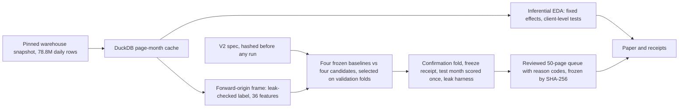

# FlyRank: Same Rank, Fewer Clicks

An early-warning ranking for pages that are losing Google clicks at the rank they already hold, the pattern AI answers
in search would cause. This is my capstone for the FlyRank ML Internship (freestyle track), built with a pre-registered V2 pipeline.

**Paper:** https://tessa-saumu.github.io/FlyRank-ML-Internship/ · **Submission guide for reviewers:** [`work/README.md`](work/README.md)

## The problem

AI answers in search (Google AI Overviews and AI Mode, ChatGPT, Perplexity, Gemini) are the new variable in FlyRank's
business. A content team can review about 50 pages a month. Which ranking pages are about to lose clicks, and should be
protected first?

## What I found

- **Same page, same position, fewer clicks.** Click-through in Google's top three positions in April 2026 was 0.642
  times its October 2025 level (95% CI 0.615 to 0.669; page fixed effects, errors clustered by client, 35 clients).
  CTR at a stable rank fell in 10 of 11 clients. Transactional pages fell more than informational ones.
- **The highest average precision in all four evaluated months, within wide intervals.** In V2, four learned candidates competed under a selection rule
  written before any run. No challenger beat the logistic champion. The champion's average precision (AP) was above all four frozen baselines in 4 of
  4 evaluated months. On the test month (May 2026, scored once) its AP was 0.333 (95% CI 0.267 to 0.424) against 0.234 for the best baseline, and its
  precision at 50 pages was 0.52 against a base rate of 0.24 (95% CI 0.32 to 0.72).
- **A prominent caveat: unmeasurable pages.** The headline P@50 is computed on pages whose outcome can be measured. Counting pages that later lost
  visibility as misses, the test month's P@50 falls from 0.52 to 0.34 and the confirmation month's from 0.60 to 0.16.
- **V2 is a process upgrade, not a better result.** On the test month V2's AP (0.333) is slightly lower than V1's (0.348) and its P@50 (0.52) higher than V1's (0.42);
  V1's values lie inside V2's intervals, so the receipts do not show a difference in either direction. V1 stays in the repository, labelled as V1.
- **The pages to protect** are those earning more clicks than their rank normally earns: that excess is what an AI
  answer can take.
- **AI-assistant discovery follows exposure, not Google rank** (within-client AUC 0.715 against 0.506).

**Disclosure.** The test month (May 2026) was seen during V1, so it is not a pristine holdout. No V2 decision (features, models, hyperparameters, selection rule) used it; all were made on validation folds whose outcome windows end before the test window opens. The V2 test result may therefore be optimistic.

Observational and decision-support only: Search Console has no AI-answer flag, so the click loss is consistent with AI
answers, not proven to be caused by them. With about five effective clients per month (4.4 to 5.8), differences in P@50 between rankers are not established.

## How it works



## Repository map

| Path | What it is |
|---|---|
| `work/` | **the submission**: notebooks (one per card), pipeline scripts (`v2_*.py` is V2), the V2 spec, receipts, figures, paper, capstone report |
| `work/archive/` | my two earlier Lane 2 (refresh) experiments, kept for the record and **not for marking** |
| `scripts/`, `notebooks/`, `outputs/` | FlyRank's starter reference pipeline and guided notebooks (unchanged) |
| `GUIDE.md`, `SETUP.md`, `DATA_USE.md` | FlyRank's operating manual, setup and data rules |

## Reproduce

```bash
pip install -r requirements.txt scipy
python work/scripts/run_notebooks.py        # reads the committed receipts; set RERUN_PIPELINE = True in a notebook to recompute (needs HF_TOKEN)
python work/scripts/verify_evidence.py      # offline checks of every receipt, the paper, the report and the frozen V2 state
```

## Data and safety

Built on the [FlyRank ML Internship dataset](https://flyrank.ai) (`FlyRank/internship-warehouse`, build v20260703).
Client identities are pseudonymized, IDs are used only for grouping, and no data, ID or query is committed. See
`DATA_USE.md`.
