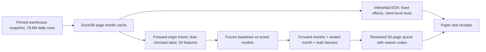

# FlyRank: Same Rank, Fewer Clicks

An early-warning ranking for pages that are losing Google clicks at the rank they already hold, the pattern AI answers
in search would cause. This is my capstone for the FlyRank ML Internship (freestyle track).

**Paper:** https://tessa-saumu.github.io/FlyRank-ML-Internship/ · **Submission guide for reviewers:** [`work/README.md`](work/README.md)

## The problem

AI answers in search (Google AI Overviews and AI Mode, ChatGPT, Perplexity, Gemini) are the new variable in FlyRank's
business. A content team can review about 50 pages a month. Which ranking pages are about to lose clicks, and should be
protected first?

## What I found

- **Same page, same position, fewer clicks.** Click-through in Google's top three positions in April 2026 was 0.642
  times its October 2025 level (95% CI 0.615 to 0.669; page fixed effects, errors clustered by client, 35 clients).
  CTR at a stable rank fell in 10 of 11 clients. Transactional pages fell more than informational ones.
- **A ranking that earns its place.** On four forward months, including a sealed month scored once after freezing, a
  logistic ranking on 34 engineered features put 42% to 66% eroding pages in a 50-page queue, against base rates of 23%
  to 34%. It led every frozen baseline on PR-AUC in all four months. The editor's intuitive rule ("top positions are most
  exposed, slipping keeps slipping") failed out of sample.
- **The pages to protect** are those earning more clicks than their rank normally earns: that excess is what an AI
  answer can take.
- **AI-assistant discovery follows exposure, not Google rank** (within-client AUC 0.715 against 0.506).

Observational and decision-support only: Search Console has no AI-answer flag, so the click loss is consistent with AI
answers, not proven to be caused by them.

## How it works



## Repository map

| Path | What it is |
|---|---|
| `work/` | **the submission**: notebooks (one per card), pipeline scripts, receipts, figures, paper, capstone report |
| `work/archive/` | my two earlier Lane 2 (refresh) experiments, kept for the record and **not for marking** |
| `scripts/`, `notebooks/`, `outputs/` | FlyRank's starter reference pipeline and guided notebooks (unchanged) |
| `GUIDE.md`, `SETUP.md`, `DATA_USE.md` | FlyRank's operating manual, setup and data rules |

## Reproduce

```bash
pip install -r requirements.txt scipy
python work/scripts/run_notebooks.py        # needs HF_TOKEN (env var or Colab secret); downloads the pinned snapshot once
python work/scripts/verify_evidence.py      # offline checks of every receipt, the paper and the report
```

## Data and safety

Built on the [FlyRank ML Internship dataset](https://flyrank.ai) (`FlyRank/internship-warehouse`, build v20260703).
Client identities are pseudonymized, IDs are used only for grouping, and no data, ID or query is committed. See
`DATA_USE.md`.
