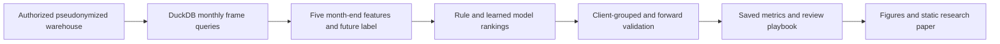
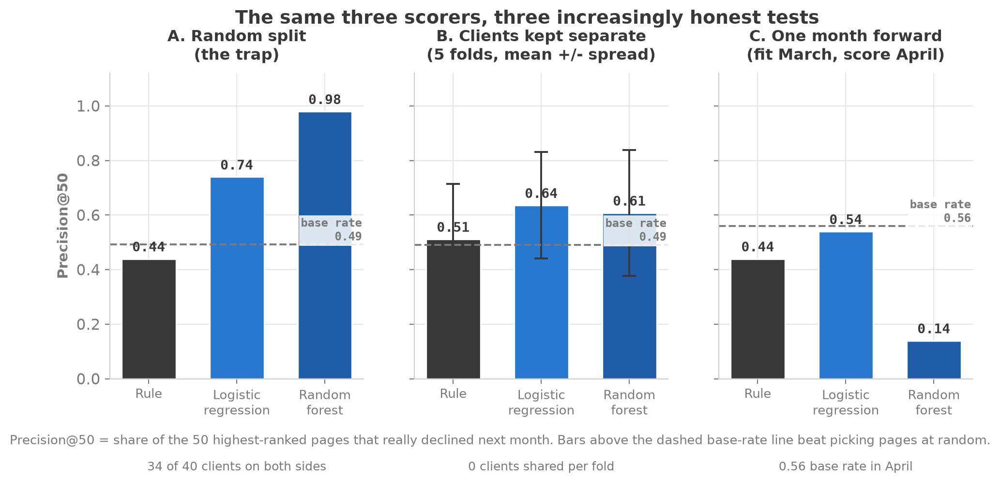

# FlyRank: Ranking Pages for Content Review

This research capstone ranks pages for a limited editorial review budget using month-end signals to estimate next-month search-impression decline.

## The problem

An editor can review only about 50 pages per month. I tested whether a learned ranking selects more pages that subsequently decline than a transparent rule. Search impressions count how often a page appears in search results; the task is review prioritization, not predicting Google's algorithm or proving that an edit restores traffic.

## What I built

My work under `work/` defines the task and data contract, builds monthly analysis frames, compares a rule with logistic regression and random forest, audits validation and translates the findings into a human-review playbook. I assembled a research paper, saved metric receipts, figures and an offline evidence checker. FlyRank supplied the curriculum, warehouse and starter pipeline.

## Architecture



## How it works

The personal notebooks query the authorized warehouse with DuckDB, a SQL analytics engine, and build one row per page per month. Eligibility and tracking checks determine the evaluated population. A rule and two models score the retained pages; evaluation compares the top 50 with observed next-month outcomes. Saved receipts feed the figures and paper. The offline checker validates these recorded results without warehouse access or retraining.

## ML / AI methodology

- **Target:** next-30-day impressions below 80% of the last-30-day value, an observed decline greater than 20%.
- **Features:** logged recent impressions, click-through rate, average search position, active days and content age, all known at month-end. Click-through rate is clicks divided by impressions.
- **Baseline/models:** transparent rule score, logistic regression and random forest.
- **Validation:** five March splits holding out whole clients, then March training with April scoring. Pages from the same client stay on one side of each grouped split.
- **Primary metric:** precision at 50 (P@50), the fraction of the 50 selected pages that actually declined. The population decline rate provides context.

## Engineering

The personal notebooks assert feature/label timing, schema and client separation. JSON receipts record metrics and populations. A pinned offline environment runs capstone cells, checks 31 headline numbers and fold counts, and regenerates five figures in a temporary directory. Figure generation and the deployment script maintain a single static paper. GitHub Actions workflows include personal-evidence checks and Pages publishing. This is batch research, with no live prediction API or automated editorial deployment.

## Results

| Evaluation | Logistic regression P@50 | Rule P@50 | Population decline rate |
|---|---:|---:|---:|
| March: mean of five client-grouped splits | 63.6% | 51.2% | about 49.1% |
| Train March, score April | 54% | 44% | about 56% |

Logistic regression won four grouped splits and lost one; random forest won three and tied two. The mean logistic-regression advantage over the rule was **12.4 percentage points**, but these overlapping splits are not independent confirmations. The grouped advantage did **not** translate into forward lift above April's population rate at the 50-page budget.

The retained March/April frames contain **95,810/99,279 pages** across **40/44 clients**. Missing or thin outcome tracking excluded **2.6%/3.6%** of candidate pages. These filters and uneven client populations constrain interpretation. [Model metrics](work/outputs/model_metrics.json) and [validation receipts](work/outputs/validation_audit_metrics.json) contain the measured details.

## Demo

The [published research paper](https://tessa-saumu.github.io/FlyRank-ML-Internship/) is live, including the corrected split comparisons and five figures. It is a static research presentation, not an interactive model service.



[Personal capstone report](work/capstone_report.md) · [Review-playbook results](work/outputs/action_playbook_summary.json)

## Run locally

From the repository root, use Python 3.12, preferably in a virtual environment:

```bash
python -m pip install -r work/requirements-evidence.txt
python work/scripts/verify_evidence.py
```

This workflow passed on 13 October 2026. It checks saved evidence and generates temporary figures; it does not access the warehouse, change the paper or retrain models. A full data-to-model rebuild requires authorized access and the `w03`–`w07` notebooks; it was not rerun in this update. Historical modelling versions remain recorded separately in the receipts.

## Repository structure

| Path | Purpose |
|---|---|
| `work/notebooks/` | My task framing, data contract, model, validation and capstone |
| `work/outputs/` | Saved personal research receipts |
| `work/scripts/`, `work/figures/`, `work/paper/` | Evidence verification, figures and deployable paper |
| Root `scripts/`, `notebooks/`, `outputs/` | Supplied starter pipeline and example results |
| `docs/`, `DATA_USE.md` | Supplied reference documentation and data-use boundaries |

[Starter setup](SETUP.md), [repository guide](GUIDE.md) and [personal work index](work/README.md) retain assignment context. Starter sample metrics describe a different target and are not my capstone results.

## Limitations

No controlled content-refresh experiment, editor adoption or revenue effect was measured. Random-split and deliberately leaked results are diagnostics, not headline performance. The approximate 79-million-row source release is not my local training scale. Access and publication boundaries remain governed by [DATA_USE.md](DATA_USE.md). A fresh warehouse/training rebuild and durable advantage across later months remain unverified.

## What I would improve next

1. Evaluate additional future months without changing selection against already-used test periods.
2. Report performance and review coverage by client to expose concentration and uneven tracking.
3. Test the review playbook with editors and a controlled intervention before making impact claims.

## My contribution

This is my individual internship capstone, with AI assistance in implementation and documentation. My work is the personal research under `work/`; FlyRank supplied the curriculum, data warehouse and reference material elsewhere. This boundary follows the documented template convention; the bundled original history cannot independently prove every authorship detail. The repository supports capstone work, not employer-verified tenure or business impact.
